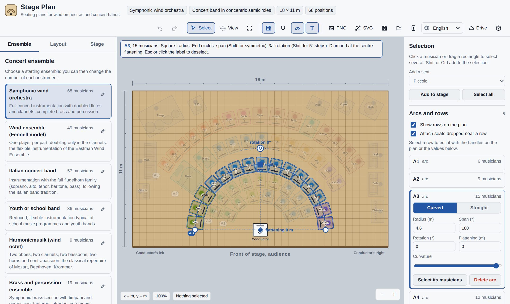

# Stage Plan (Pianta di scena)

Applicazione web per disporre gli orchestrali di un’orchestra di fiati o di una banda sul palco. Funziona nel browser, si installa come app su telefono e computer, lavora anche senza connessione, salva i progetti su Google Drive ed è disponibile in otto lingue.

[Read in English](README.md)

## Funzioni principali

- **Formazioni pronte e modificabili**: orchestra di fiati sinfonica, wind ensemble (modello Fennell), banda all’italiana con flicorni, banda giovanile, Harmoniemusik, ottoni e percussioni, brass band britannica, fanfara. Ogni preset si può modificare, duplicare o creare da zero.
- **Tipologie di disposizione** con descrizione e testi di riferimento, anch’esse modificabili fascia per fascia.
- **Ingombri reali** di sedia, leggio e strumento, modificabili.
- **Musicista, leggio e strumento** come parti distinte di ogni posizione: uno strumento ingombrante (timpani, xilofono…) può restare senza musicista, un leggio può essere condiviso da più musicisti o tolto, e singole posizioni o file intere possono stare su una **pedana**, disegnata come un leggero contorno tratteggiato con l’altezza in cm. L’analisi conta musicisti, leggii e pedane.
- **Archi e file rettilinee** modificabili con le maniglie; ogni fila può passare da arco a linea e viceversa.
- **Selezione multipla**, allineamento, rotazione con maniglia, opzione “sempre rivolto al direttore”.
- **Controlli automatici**, esportazione PNG e SVG, progetti in JSON, annulla e ripeti.
- **Google Drive** con salvataggio automatico e gestione dei conflitti.
- **App installabile** e utilizzabile offline.
- **Otto lingue**: la lingua del browser viene riconosciuta da sola e si cambia dalla barra degli strumenti.
- **Qualsiasi schermo**: smartphone (verticale e orizzontale), tablet, portatili e monitor fino al 4K. Sugli schermi piccoli i pannelli laterali diventano cassetti a scomparsa e gli strumenti secondari finiscono nel menu «Altro»; sugli schermi touch c’è lo zoom a due dita e le maniglie sono più grandi.

## Pubblicazione su GitHub Pages

1. Crea un repository pubblico su GitHub e carica tutti i file. Se li trascini dal sito, controlla che sia stata caricata la cartella nascosta `.github`; se manca, creala con **Add file › Create new file** e il percorso `.github/workflows/pages.yml`.
2. **Settings › Pages › Source: GitHub Actions**. Dopo circa un minuto l’app è online su `https://TUO-UTENTE.github.io/NOME-REPOSITORY/`.

I comandi Git e i dettagli sono nel [README in inglese](README.md#publishing-on-github-pages).

## Collegare Google Drive

1. Su [console.cloud.google.com](https://console.cloud.google.com) crea un progetto e abilita **Google Drive API**.
2. In **Google Auth Platform** configura l’app come **Esterna**, aggiungi l’ambito `https://www.googleapis.com/auth/drive.file` e premi **Pubblica app**.
3. In **Client** crea un client **Applicazione web** e, tra le **Origini JavaScript autorizzate**, inserisci solo il dominio `https://TUO-UTENTE.github.io`, senza nome del repository e senza barra finale.
4. Copia l’ID client e salvalo in **Settings › Secrets and variables › Actions › Variables** con il nome `GOOGLE_CLIENT_ID`, poi riavvia il flusso dalla scheda **Actions**.

In alternativa puoi scriverlo in `config.js` oppure incollarlo nella finestra **Drive** dell’app (vale solo per quel dispositivo). L’ID client non è un dato segreto. L’ambito `drive.file` è tra quelli che Google considera non sensibili, quindi di norma non serve la verifica di sicurezza.

## Riferimenti bibliografici

Le tipologie di disposizione citano testi di riferimento: verifica edizioni e pagine prima di riportarli in programmi di sala o lavori di studio.

## Licenza

Licenza MIT: vedi [LICENSE](LICENSE). Prima di pubblicare, sostituisci il segnaposto con il tuo nome o quello della banda.
