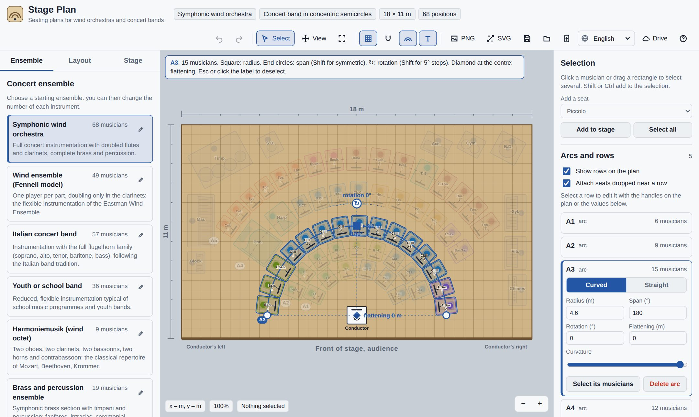

# Podium

A web app for seating the players of a wind orchestra or concert band on stage. It runs in the browser, installs as an app on phones and computers, works offline, can save projects to Google Drive, and is available in eight languages.

**Languages:** English · Italiano · Español · Français · Deutsch · Português · 日本語 · 中文 — [Leggi in italiano](README.it.md)



## Features

- **Ready-made, editable ensembles**: symphonic wind orchestra, wind ensemble (Fennell model), Italian band with flugelhorns, youth band, Harmoniemusik, brass and percussion, British brass band, fanfare band. Every preset can be edited, duplicated or created from scratch.
- **Layout types** with descriptions and reference texts: concentric semicircles, wind ensemble by choirs, Italian band, European harmonie, sectors by family, chamber semicircle, brass band, straight rows. These are editable presets too, band by band.
- **Real footprints** for chair, stand and instrument, all adjustable; percussion, harp and piano get their own space.
- **Musician, stand and instrument** as separate parts of each position: a bulky instrument (timpani, xylophone…) can stand without its musician, a music stand can be shared by several musicians or removed, and single positions or whole rows can go on a **riser**, drawn as a light dashed outline with its height in cm. The analysis counts musicians, stands and risers.
- **Ensembles remember their set-up**: shared stands, risers and instruments without musician are saved with the ensemble (by instrument and stand number) and applied every time it is placed on stage. Regenerating with another layout keeps them.
- **Starts on an empty stage**: choose an ensemble to begin, or resume the last plan with one click.
- **Checklist for the stage crew**: musicians expected, chairs, music stands, risers by height (with their area) and instruments without musician, shown in the side panel and optionally added to PNG and SVG exports with tick boxes.
- **Arcs and straight rows** drawn on the plan and edited with handles: radius, span, rotation, flattening, length, tilt. Any row can switch between curved and straight; players redistribute automatically.
- **Multiple selection** by click or rectangle, moving, alignment, rotation handle, “always face the conductor” option.
- **Automatic checks**: overlaps, seats off the stage, footprint and density.
- **Export** to PNG and SVG, projects saved and opened as JSON, unlimited undo and redo.
- **Google Drive**: automatic saving, project list, conflict detection between devices, preset sync.
- **Installable app (PWA)** that also works offline.
- **Eight languages**, detected from the browser and switchable from the toolbar.
- **Any screen size**: phones (portrait and landscape), tablets, laptops and large monitors up to 4K. On smaller screens the side panels become slide-out drawers and secondary tools fold into a “More” menu; touch screens get pinch-to-zoom and larger handles.

## Repository layout

| File | Contents |
|---|---|
| `index.html` | The complete application, including all translations |
| `config.js` | Configuration: Google client ID |
| `drive.js` | Google Drive integration and its translations |
| `sw.js` | Service worker for installation and offline use |
| `manifest.webmanifest` | Name, icons and colours of the installed app |
| `icons/` | Icons for Android, iPhone and desktop |
| `.github/workflows/pages.yml` | Automatic deployment to GitHub Pages |
| `docs/` | Images used by the README |

There is no build step: these are static files.

## Publishing on GitHub Pages

### 1. Create the repository and upload the files

**From the GitHub website, no tools needed**

1. On github.com press **New repository**, pick a name (for example `stage-plan`), choose **Public**, and create it without a README.
2. Press **uploading an existing file**, drag in all the files and folders of this project and confirm with **Commit changes**.
3. Check that the `.github` folder appears in the repository. On macOS and Windows, files whose names start with a dot are often hidden and do not get uploaded. If it is missing, press **Add file › Create new file**, type `.github/workflows/pages.yml` as the name, paste the content of that file and commit.

**With Git, from a terminal**

```bash
cd stage-plan
git init -b main
git add .
git commit -m "First release of Stage Plan"
git remote add origin https://github.com/YOUR-USER/stage-plan.git
git push -u origin main
```

### 2. Turn on GitHub Pages

1. In the repository open **Settings › Pages**.
2. Under **Build and deployment › Source** choose **GitHub Actions**.
3. Open the **Actions** tab: the “Deploy to GitHub Pages” workflow runs on every push to `main`. If it has not started yet, launch it with **Run workflow**.
4. After about a minute the app is online at `https://YOUR-USER.github.io/stage-plan/`.

The workflow bumps the cache version on every deployment, so people who installed the app always get the latest version.

> Alternatively you can choose **Deploy from a branch** (branch `main`, folder `/root`). It works the same, but on every update you must change `stageplan-v1` in `sw.js` by hand (for example to `v2`), and the client ID has to be written in `config.js`.

## Connecting Google Drive

You need a free OAuth client ID, created once.

1. Go to [console.cloud.google.com](https://console.cloud.google.com) and create a project, for example “Stage Plan”.
2. **APIs & Services › Library**: search for **Google Drive API** and press **Enable**.
3. **Google Auth Platform** (called “OAuth consent screen” in older versions): user type **External**, app name, support and contact email.
4. **Data access**: add the scope `https://www.googleapis.com/auth/drive.file`, which only gives access to files created by the app.
5. **Audience**: press **Publish app**. While it stays “In testing”, only accounts added as test users can sign in.
6. **Clients › Create client**, type **Web application**. Under **Authorised JavaScript origins** enter the domain only, without the repository name and without a trailing slash:
   ```
   https://YOUR-USER.github.io
   ```
   No redirect URIs are needed.
7. Copy the **client ID** (it ends with `.apps.googleusercontent.com`).

Then provide it in one of these ways:

- **Repository variable (recommended)**: **Settings › Secrets and variables › Actions › Variables › New repository variable**, name `GOOGLE_CLIENT_ID`, value the client ID. Redeploy by running the workflow again from the **Actions** tab.
- **`config.js` file**: write the ID between the quotes of `googleClientId` and commit.
- **From the app**: **Drive** button, paste the ID in the window. This only applies to that device.

A client ID is not a secret: it is normal for it to be visible in a web page’s code. Protection comes from the authorised origins set in Google Cloud.

The `drive.file` scope is one Google classes as non-sensitive, so as a rule the app does not need Google’s security verification. Changes to authorised origins can take a few minutes to take effect.

## Installing the app

- **Android (Chrome)**: an “Install” banner appears, or use menu ⋮ › **Install app**.
- **iPhone and iPad (Safari)**: **Share › Add to Home Screen**.
- **Desktop (Chrome or Edge)**: install icon in the address bar.

## Using Google Drive in the app

- **Drive › Sign in with Google**, then **Save to Drive**: the project goes into the “Stage Plan” folder of your Drive, together with your custom presets.
- With **automatic saving** on, every change is saved a few seconds later. The dot on the Drive icon shows the state: green saved, blue saving, orange reconnect or conflict, red error.
- If the same file is changed on another device, the app asks whether to overwrite it or open the Drive version.
- A Google session lasts about an hour; after that, tap **Drive › Resume Google session**.
- On iPhone, if sign-in does not complete from the installed app, open the site in Safari and sign in there.

## Translations

All interface text lives in the `I18N` dictionaries: in `index.html` for the app and in `drive.js` for Google Drive. English (`en`) is the reference; any missing key falls back to it. To add a language, copy the `en` block, translate the values, add the code to `LANGS` and `LOCALES` at the top of the app script, and add a matching block in `drive.js`.

## Running locally

The service worker and Google Drive need an `http://localhost` or `https` address, not a file opened directly:

```bash
python3 -m http.server 8000
```

then open `http://localhost:8000`. To try Google Drive locally, also add `http://localhost:8000` to the client’s authorised origins.

## Bibliographic references

The layout types cite reference works (Fennell, Battisti, Goldman, Vessella and others). Check editions and pages before quoting them in concert programmes or academic work.

## Licence

Released under the MIT licence: see [LICENSE](LICENSE). Before publishing, replace the placeholder in that file with your name or your band’s name.
